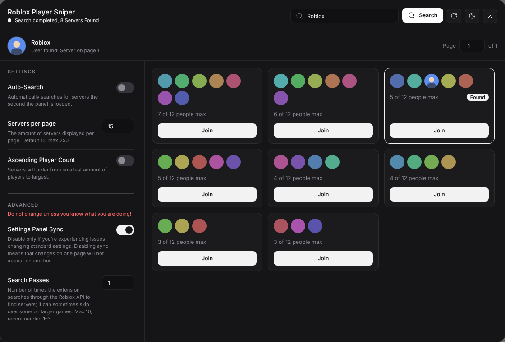
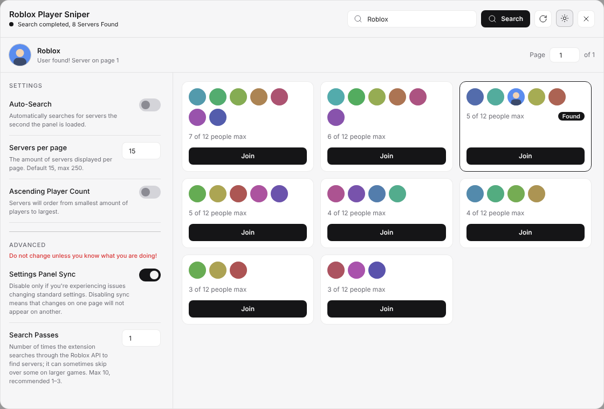

<div align="center">


# Roblox Server Sniper

**Find a specific Roblox player in a game's public servers by their avatar — and join their server in one click.**

    [](LICENSE)

<br>



</div>

---

## Features

- **One button, full-size panel.** A single **Find player** button on every game page opens the whole tool.
- **Search by username.** Type a name, press <kbd>Enter</kbd> or click **Search**.
- **Server cards with avatars.** Player count, avatars of the players inside, and a one-click **Join**.
- **Region, uptime & Job ID.** Every card shows its Job ID (click to copy); press **Get server info** on a card to load the data-center region and an estimated uptime (live counter).
- **Target highlighted.** The server that contains your player gets a border and a **Found** badge.
- **Friends shown.** Friends who are in a server are listed on its card.
- **Pagination.** Configurable servers per page (default 15, max 250).
- **Sorting.** Order servers by ascending or descending player count.
- **Auto-Search.** Optionally start searching as soon as the game page loads.
- **Light & dark theme.** Follows Roblox by default, switchable with one click.
- **Polished UI.** Smooth animations plus clear loading, empty and error states.

<details>
<summary>Light theme preview</summary>
<br>

</details>

> Screenshots use mock data.

## Installation

1. Download the latest `.zip` from the [Releases](../../releases) page and unzip it.
2. Open `chrome://extensions` in Chrome (or any Chromium browser) and enable **Developer mode**.
3. Click **Load unpacked** and select the unzipped folder.
4. Open any Roblox game page — the **Find player** button appears above the server list.

## Usage

1. Open a game page on roblox.com and click **Find player**.
2. Enter the player's username in the search field.
3. Press <kbd>Enter</kbd> or click **Search**.
4. Wait for the search to finish. The server with your player is marked **Found** — click **Join**.

Use the settings on the left of the panel to change the page size, sort order and Auto-Search.

## How it works

The extension reads the game's public server list, fetches avatar thumbnails for the players in
every server, and compares them with the thumbnail of the username you entered. Everything runs
locally in your browser and talks only to Roblox's public APIs. No data is sent anywhere else.

## Settings

| Setting | Description |
| --- | --- |
| Auto-Search | Start searching as soon as the game page loads. |
| Servers per page | How many servers are shown per page. Default 15, max 250. |
| Ascending Player Count | Order servers from fewest to most players. |
| Search Passes | *(Advanced)* How many times the server list is scanned. Max 10, recommended 1–3. |

## Privacy

To show region and uptime, when you press **Get server info**, the extension sends the game's place ID and that server's Job ID to the public RoValra API (`apis.rovalra.com`). No cookies, usernames or account data are sent. If the API is unreachable, cards simply show "—".

## Troubleshooting

- **"User not found"** — the player may not be in any public server, may be hidden by Roblox, or
  was missed by the scan. Try again, or increase **Search Passes**.
- **Search is slow or shows errors in the console** — Roblox rate-limits requests (HTTP 429) on
  very large games. The extension retries automatically, so searches there simply take longer.
- **Nothing happens on a game page** — reload the page after installing or updating the extension.

## Project structure

```
manifest.json          Extension manifest (MV3)
background.js          Service worker (settings sync)
html/main.html         Panel markup injected into game pages
js/pages/content.js    Search logic and panel behaviour
css/main.css           Panel styles
```

## Star history

<a href="https://star-history.com/#Tweety0ff/Roblox-Server-Sniper&Date">
  <picture>
    <source media="(prefers-color-scheme: dark)" srcset="https://api.star-history.com/svg?repos=Tweety0ff/Roblox-Server-Sniper&type=Date&theme=dark" />
    <source media="(prefers-color-scheme: light)" srcset="https://api.star-history.com/svg?repos=Tweety0ff/Roblox-Server-Sniper&type=Date" />
    
  </picture>
</a>

If this project helps you, consider giving it a ⭐ — it's the easiest way to support it.

## Credits

Based on [Restore Old Roblox Server List](THIRD_PARTY_NOTICES.md) by Lucas.
Icons by [Lucide](https://lucide.dev). Uses [jQuery](https://jquery.com).

## License

Released under the [MIT License](LICENSE) © 2026 Tweety0ff.
See [THIRD_PARTY_NOTICES.md](THIRD_PARTY_NOTICES.md) for third-party components.

*Not affiliated with, endorsed by, or sponsored by Roblox Corporation.*
